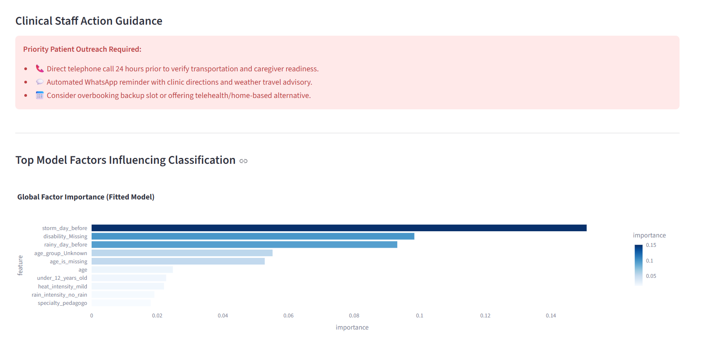
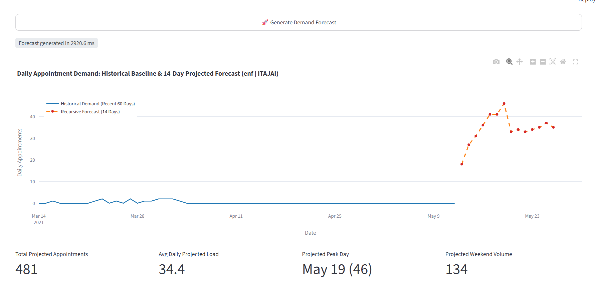
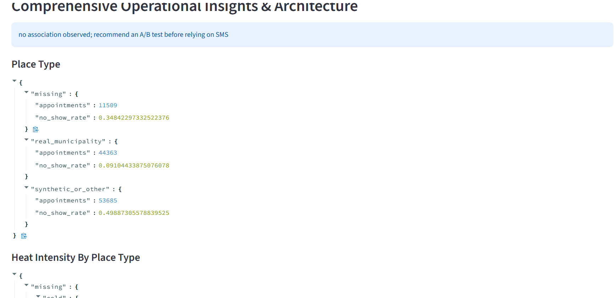

# Medical Appointment No-Show Prediction and Demand Forecasting

Python and Streamlit tools for appointment no-show risk and daily demand forecasting.

## Data quality

`place` contains many synthetic Faker-style values, which are normalized to `UNKNOWN_SYNTHETIC`; missing values remain `MISSING`. The generated `outputs/business_insights.md` reports cleaned row counts and rates by place type (synthetic/other, real municipality, and missing). This distinction matters because synthetic place values have a much higher no-show rate and are associated with `heavy_cold` more often, confounding unstratified weather comparisons.

Weather fields vary by appointment row within the same date. The forecaster therefore uses calendar, lag, and rolling-count features only. The source has near-empty periods in January 2020, November 2020, and May 2021; forecasts across such periods should be interpreted cautiously.

Place-type counts and rates (generated from cleaned data):

<!-- GENERATED_PLACE_STATS_START -->
| Place type | Appointments | No-show rate |
|---|---:|---:|
| missing | 11,509 | 34.8% |
| real_municipality | 44,363 | 9.1% |
| synthetic_or_other | 53,685 | 49.9% |
<!-- GENERATED_PLACE_STATS_END -->

Missing age is represented as the `Unknown` age group and retained in `age_is_missing`; it is not assigned to a child age band. `sem especialidade` is a specialty value distinct from blank specialty.

## Models and evaluation

The classification pipeline saves both `full` and `no_place` variants. The app deploys `no_place`. Exact classifier metrics and library versions are in `outputs/classification_report.json`.

PDF target audit (generated from report JSON):

<!-- GENERATED_TARGET_AUDIT_START -->
Deployed classifier: no_place / XGBoost. Forecast selected by recursive WAPE: Random Forest Regressor.

| Variant | Selected model | ROC-AUC | Positive-class F1 |
|---|---|---:|---:|
| full | XGBoost | 0.7860 | 0.6399 |
| no_place | XGBoost | 0.7629 | 0.6116 |

- **Positive-class F1 > 0.70:** MISSED (0.6116).
- **Forecast R² > 0.65:** MISSED (0.0097).
- **Forecast MAPE < 20%:** MISSED (1411.3918).
<!-- GENERATED_TARGET_AUDIT_END -->

Forecast models are compared on the same chronological split under one-step-ahead and recursive fourteen-day rolling-origin protocols. The selected model minimizes recursive WAPE. R², MAE, RMSE, WAPE, sMAPE, overall MAPE, and MAPE on days with at least ten appointments are in `outputs/forecasting_report.json`. Read those reports for the current PDF target results; no target is assumed achieved in advance.

Business insights, including no-show by place type, heat stratified by place type, SMS association, age (including Unknown), specialty, companion, shift, weekday volume, and health segments, are computed into `outputs/insights.json` and `outputs/business_insights.md`. SMS showed no association in the supplied review; an A/B test is recommended before relying on SMS. Capacity recovery is not projected without explicit intervention inputs and test prediction evidence.
## Setup

> Tested on Python 3.14.7 (Windows 10/11). Other versions may need different package versions than those pinned in `requirements.txt`.

pip install -r requirements.txt
## Run

Install the exact dependency versions from `requirements.txt`, then run:

```powershell
python run_pipeline.py
pytest
streamlit run app.py
```

`data/raw.csv` is local and gitignored. Data-dependent tests skip when it is absent. `data/daily_series.csv` supports aggregate forecasting when the raw file is unavailable.

## Screenshots



